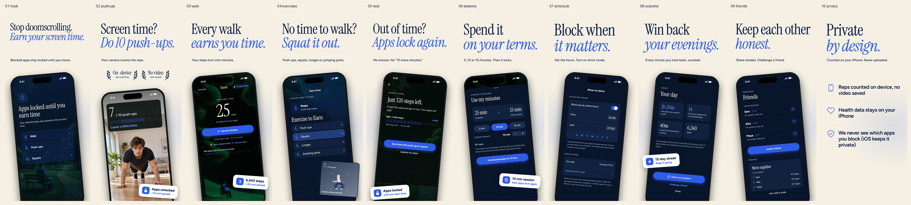
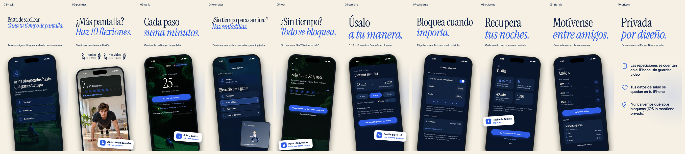

# Earn Screen Time — App Store screenshots

Ten frames in English (`en-US`) and neutral *tú* Spanish (`es`, shared by es-ES and es-MX). Each language has ten PNGs in every size: **60 export PNGs total**, plus two contact sheets.

| Folder | Dimensions | Export size |
| --- | --- | --- |
| `6.9-inch/` | 1290 × 2796 | Large iPhone |
| `6.3-inch/` | 1206 × 2622 | Smaller iPhone |
| `6.1-inch/` | 1179 × 2556 | Older smaller iPhone |

| # / source | Headline EN | Headline ES | Shows |
| --- | --- | --- | --- |
| 01 / `01-hook.html` | Stop doomscrolling. *Earn your screen time.* | Basta de scrollear. *Gana tu tiempo de pantalla.* | Shield with Walk, Push-ups and Squats routes |
| 02 / `02-pushups.html` | Screen time? *Do 10 push-ups.* | ¿Más pantalla? *Haz 10 flexiones.* | Push-up camera at 7 / 10, on-device and no-video facts |
| 03 / `03-walk.html` | Every walk *earns you time.* | Cada paso *suma minutos.* | Home balance, steps, earnings and skipped opens |
| 04 / `04-exercises.html` | No time to walk? *Squat it out.* | ¿Sin tiempo para caminar? *Haz sentadillas.* | Earn exercise list and illustrated squat camera inset |
| 05 / `05-lock.html` | Out of time? *Apps lock again.* | ¿Sin tiempo? *Todo se bloquea.* | Shield, 320 steps from the next reward |
| 06 / `06-sessions.html` | Spend it *on your terms.* | Úsalo *a tu manera.* | 5 / 10 / 15 minute session picker |
| 07 / `07-schedule.html` | Block when *it matters.* | Bloquea cuando *importa.* | 21:00–07:00 blocking hours with strict mode active |
| 08 / `08-outcome.html` | Win back *your evenings.* | Recupera *tus noches.* | Your day report and 12-day streak |
| 09 / `09-friends.html` | Keep each other *honest.* | Motívense *entre amigos.* | Three friends with streaks and an ongoing weekly squad challenge |
| 10 / `10-privacy.html` | Private *by design.* | Privada *por diseño.* | Three privacy facts, without a phone |

**Look:** ivory #F5F0E3, navy #0B1F45, cobalt as the only UI accent; bundled Instrument Serif headlines and Figtree text. There is no brand lockup. Headlines have exactly two lines, with a cobalt italic second line, followed by one subline. `fit.js` fits the supplied copy into those lines after the fonts load (up to 240 px); the longer hook and Spanish exercise headline necessarily use smaller sizes.

**Sample day:** 6,240 steps (6.240 in Spanish), 40 min earned, 25 min available, 14 skipped opens and a 12-day streak. The selected 10-minute session leaves 15 min. The shield's 680 / 1,000 and 320 steps remaining are the requested illustrative reward-progress state, not an additional daily total. The shield and camera frames illustrate separate moments, not a simultaneous live account state. Friend streaks (12, 8 and 6 days) and weekly standings are fixture data.

**Phone redraws:** sourced from `BlockedAppDetailView`, `EarnTimeView`, `PushupsToEarnView`, `BlockingPolicyView`, `FriendsView`, the dashboard, spending sheet and impact report. Phone copy comes from `Localizable.xcstrings` and `PushupsLocalizable.xcstrings`; see [copy notes](COPY_NOTES.md) for composed text. The hook and exercise list combine existing app elements to follow the brief. Friends shows a weekly squad in progress: the app has squads and a share challenge action, but no separate pending-challenge inbox. Strict mode uses the real active-until and extend rows, not a switch that suggests it can be turned off early.

**Artwork:** the app's illustrated scenes remain in use. `src/pushup.png` is the existing AI-generated push-up photo. The squat inset is an SVG illustration of a camera pose with joint tracking, not an actual camera capture. Badges state only the two requested product facts: on-device counting and no saved video. No hidden earning feature appears.

## Editing and rendering

- `frames.json` defines the order, filenames and exact EN/ES marketing copy.
- Edit English HTML in `src/`. `base.css`, `light.css` and `set.css` define the shared visual system; `common.js` supplies status bars and meters.
- Update `make_es.py` for any text changes. Every swap asserts that its English source occurs exactly once. Spanish HTML is generated temporarily and cleaned up even after a failed render.
- Run `./render.sh` from this folder. It needs Python 3 with Pillow, Node with Playwright, and Playwright Chromium. If Playwright is installed outside the project, set `NODE_PATH` to its package directory.
- `render.js` renders only the ten manifest entries in the two supported languages, removes stale export PNGs and checks exact copy, two headline lines, one subline, text bounds, separation from the phone, hidden-feature text, the exercise inset and privacy-fact bounds.
- `resize.py` creates the two smaller sizes, asserts every filename and dimension in all six output folders, then generates ten-across contact sheets in `previews/`.
- Inspect both contact sheets after every change; inspect individual exports for details. The renderer catches geometry issues, but visual inspection is still required.

## Previews

Nothing in this workflow uploads to App Store Connect or changes `fastlane/metadata`.
