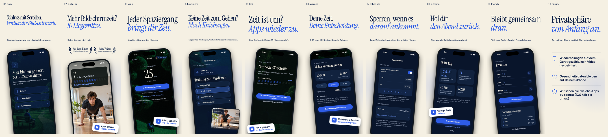
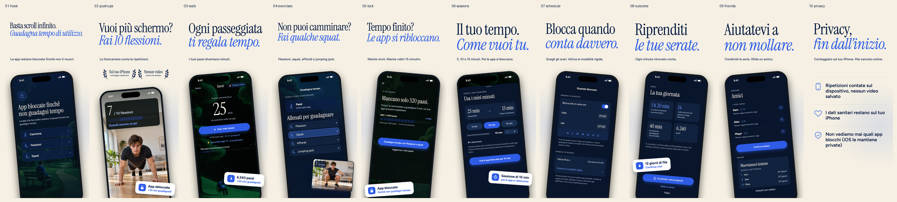
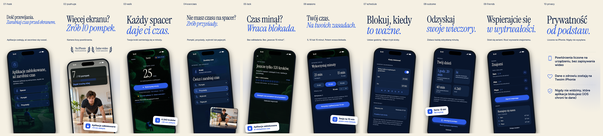
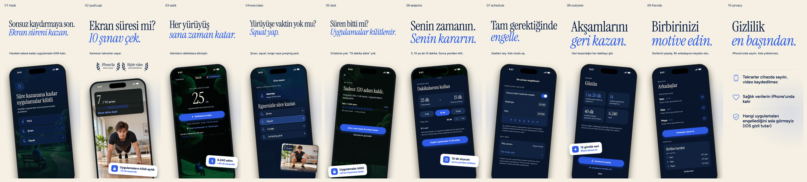
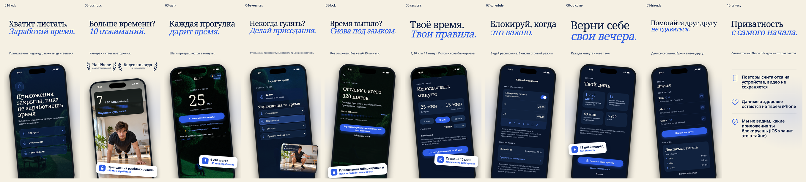

# Earn Screen Time — App Store screenshots

Ten frames in **14 languages**, exported only for the **6.3-inch / iPhone with Dynamic Island (medium)** slot: **1206 × 2622**, **140 PNGs total**, plus 14 contact sheets. Layout remains at 1290 × 2796 in ignored `.build/<language>/`; LANCZOS resampling creates the store exports.

| Export folder under `6.3-inch/` | Store locale(s) | Language |
| --- | --- | --- |
| `en-US` | en-US, en-GB | English |
| `es` | es-ES, es-MX | Spanish |
| `de` | de-DE | German |
| `fr` | fr-FR | French |
| `it` | it | Italian |
| `pt-BR` | pt-BR | Brazilian Portuguese |
| `nl` | nl-NL | Dutch |
| `pl` | pl | Polish |
| `tr` | tr | Turkish |
| `ru` | ru | Russian |
| `ja` | ja | Japanese |
| `ko` | ko | Korean |
| `zh-Hans` | zh-Hans | Simplified Chinese |
| `ar` | ar-SA | Arabic |

| # / source | Headline EN | Headline ES | Shows |
| --- | --- | --- | --- |
| 01 / `01-hook.html` | Stop doomscrolling. *Earn your screen time.* | Basta de scrollear. *Gana tu tiempo de pantalla.* | Shield with Walk, Push-ups and Squats routes |
| 02 / `02-pushups.html` | Screen time? *Do 10 push-ups.* | ¿Más pantalla? *Haz 10 flexiones.* | Push-up camera at 7 / 10, on-device and no-video facts |
| 03 / `03-walk.html` | Every walk *earns you time.* | Cada paso *suma minutos.* | Home balance, steps, earnings and skipped opens |
| 04 / `04-exercises.html` | No time to walk? *Squat it out.* | ¿Sin tiempo para caminar? *Haz sentadillas.* | Earn exercise list and photorealistic squat camera inset |
| 05 / `05-lock.html` | Out of time? *Apps lock again.* | ¿Sin tiempo? *Todo se bloquea.* | Shield, 320 steps from the next reward |
| 06 / `06-sessions.html` | Spend it *on your terms.* | Úsalo *a tu manera.* | 5 / 10 / 15 minute session picker |
| 07 / `07-schedule.html` | Block when *it matters.* | Bloquea cuando *importa.* | 21:00–07:00 blocking hours with strict mode active |
| 08 / `08-outcome.html` | Win back *your evenings.* | Recupera *tus noches.* | Your day report and 12-day streak |
| 09 / `09-friends.html` | Keep each other *honest.* | Motívense *entre amigos.* | Three friends with streaks and an ongoing weekly squad challenge |
| 10 / `10-privacy.html` | Private *by design.* | Privada *por diseño.* | Three privacy facts, without a phone |

**Look:** ivory #F5F0E3, navy #0B1F45, cobalt as the only UI accent; bundled Instrument Serif headlines and Figtree text. There is no brand lockup. Headlines have exactly two lines, with a cobalt italic second line, followed by one subline. `fit.js` fits the supplied copy into those lines after the fonts load (up to 240 px, constrained by the gap above the subline); the longer hook and Spanish exercise headline necessarily use smaller sizes.

**Sample day:** 6,240 steps (6.240 in Spanish), 40 min earned, 25 min available, 14 skipped opens and a 12-day streak. The selected 10-minute session leaves 15 min. The shield's 680 / 1,000 and 320 steps remaining are the requested illustrative reward-progress state, not an additional daily total. The shield and camera frames illustrate separate moments, not a simultaneous live account state. Friend streaks (12, 8 and 6 days) and weekly standings are fixture data.

**Phone redraws:** sourced from `BlockedAppDetailView`, `EarnTimeView`, `PushupsToEarnView`, `BlockingPolicyView`, `FriendsView`, the dashboard, spending sheet and impact report. Phone copy comes from `Localizable.xcstrings` and `PushupsLocalizable.xcstrings`; see [copy notes](COPY_NOTES.md) for composed text. The hook and exercise list combine existing app elements to follow the brief. Friends shows a weekly squad in progress: the app has squads and a share challenge action, but no separate pending-challenge inbox. Strict mode uses the real active-until and extend rows, not a switch that suggests it can be turned off early.

**Artwork:** the app's illustrated scenes remain in use. `src/pushup.png` is the existing AI-generated push-up photo. The squat inset uses `src/squat.png`, an AI-generated photorealistic image matched to the push-up photo. Both images depict people; neither is a capture from the live app. Generation details are in [IMAGE_PROMPTS.md](IMAGE_PROMPTS.md). Badges state only the two requested product facts: on-device counting and no saved video. No hidden earning feature appears.

## Editing and rendering

- `frames.json` defines order, filenames and each language's two headline lines and subline.
- Edit the English HTML in `src/`. `base.css`, `light.css` and `set.css` define the original composition; `l10n.css` supplies the new locales' typography and Arabic text alignment without moving or reflecting the phone artwork.
- `l10n/<language>.json` holds one exact swap table per language. Every English source must occur exactly once. `make_l10n.py` generates `src/<frame>.<language>.html`; these files are ignored and `render.sh` removes only its manifest pages, even on failure. The original Spanish swaps are preserved.
- Phone labels use existing xcstrings translations for de, fr, it, pt-BR and ja wherever available, including formatted catalog values. Remaining text is screenshot-only copy. Each new locale's table records provenance; [TRANSLATION_REVIEW.md](TRANSLATION_REVIEW.md) lists **every non-catalog translation and composition** for native review. Run `python3 review_copy.py` after edits. Original English/Spanish compositions remain documented in [COPY_NOTES.md](COPY_NOTES.md).
- Run `./render.sh` here. It needs Python 3 with Pillow, Node with Playwright, and Playwright Chromium. If Playwright is installed outside the project, set `NODE_PATH` to its package directory. Rendering works offline: external requests and missing resources fail validation.
- `render.js` renders all manifest frames and languages to `.build/`, removes stale temporary PNGs and checks exact copy, two headline lines, a single subline, bounds, phone separation, hidden-feature text, exercise inset clearance, callout/UI overflow and privacy-fact bounds. `fit.js` fits both width and available headline height. `FIRST_PASS=1 node render.js` renders the hook in every locale for a font sanity check; `LANGUAGES=ja,ar node render.js` narrows a debugging run. These options affect only the renderer; `render.sh` always requires the complete export set.
- `resize.py` exports only `6.3-inch/`, verifies exactly ten manifest filenames and 1206 × 2622 dimensions per language, then makes contact sheets **from those export files** in `previews/`. There are no 6.9-inch or 6.1-inch exports.
- Inspect every contact sheet after changes, plus individual exports at full size for phone copy. Geometry checks complement visual review.

## Fonts and verification

Instrument Serif and Figtree retain their original Latin typography; their regular/italic and used weights were checked for the Polish and Turkish characters. The new script fonts are bundled, licensed Noto subsets: Serif/Sans JP, KR and SC; Serif/Sans for Cyrillic; Naskh/Sans Arabic. See [font sources and licenses](src/fonts/README.md). Arabic pages set `dir="rtl"`; marketing text and privacy rows align right while phone artwork retains its original position and orientation.

Run `python3 verify.py --baseline a8a1a06` to verify export completeness and pixel-compare EN/ES against a Git revision (use the pre-change revision once the PR is committed). `python3 verify.py --fonts` additionally checks every localized letter, mark and digit in both font families, including the original Latin weights; this optional audit needs FontTools. `bundle_fonts.py` regenerates the subsets from pinned, checksum-verified upstream fonts after copy changes and also needs FontTools with WOFF2 support. Ordinary renders need neither font downloads nor FontTools.

## Previews

Nothing in this workflow uploads to App Store Connect or changes `fastlane/metadata`.
